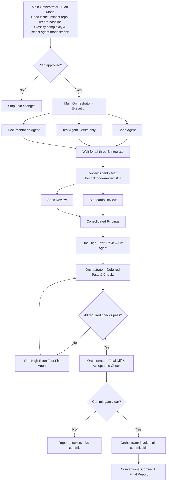

# GitHub Issue Workflow

A reusable agent skill to implement **any GitHub issue** with strict parallel implementation, independent standards/spec review, high-effort remediation, deferred validation, and a final Conventional Commit.

## How it works

The **main session starts in Plan Mode**. It reads the issue, maps requirements to the repository, identifies a fixed Git baseline, notes any unrelated working-tree edits, and presents a plan. **No edits or tests happen in Plan Mode.** Once the plan is approved and execution begins, the orchestrator launches exactly **three parallel, clean-context agents**: one for production code, one for automated tests (written but not run), and one for documentation.

When all three finish, a review agent invokes **Matt Pocock's installed `code-review` skill**, reviewing the changes **since the baseline** on two axes: **Standards** (documented repository standards) and **Spec** (the originating issue). The review skill's own parallel subagents examine those axes and report them side by side. One high-effort agent addresses actionable findings.

**Only after review remediation** does the orchestrator run builds, checks, and tests in increasing scope. If something fails, a high-effort debugging agent fixes root causes and the orchestrator reruns checks. On success, the **orchestrator itself invokes the installed `git-commit` skill** to create a Conventional Commit. No separate commit agent; no automatic push or PR.

## Workflow diagram



> The implementation agents run concurrently; later phases are sequential. The Standards and Spec branches are launched by the **code-review skill itself**, not by extra implementation agents.

## Implementation model selection

During Plan Mode, the orchestrator classifies the issue and records its rationale and each implementation agent's requested model and reasoning effort in the plan. Model selection requires no separate user approval.

Default model assignments:

| Agent | Claude Code | Codex |
| --- | --- | --- |
| Code | Sonnet 5.5 | GPT-6.1 Sol |
| Tests | Sonnet 5.5 | GPT-6.1 Sol |
| Documentation | Haiku 5.5 | GPT-6 Luna |

The three complexity profiles select default effort for both hosts, where supported:

| Complexity | Code | Tests | Documentation |
| --- | --- | --- | --- |
| Simple | Medium | Medium | Low |
| Standard | High | Medium | Low |
| Complex | High | High | Medium |

- **Simple:** Localized changes, straightforward behavior, limited dependencies.
- **Standard:** Multiple related changes, moderate logic, or meaningful regression risk.
- **Complex:** Architectural changes, concurrency, advanced DSP, numerical algorithms, realtime constraints, or substantial cross-module interactions.

Uncertain complexity defaults to **Standard**. Resolve model and effort independently per role: **explicit per-role settings in the invoking request → explicit per-role host settings → documented defaults**. No new configuration file is needed.

Before launching exactly three concurrent agents, the orchestrator checks runtime capabilities and explicitly configures supported model and effort settings. Display names are mapped only to verified runtime identifiers. If a requested model or effort is unavailable, use the closest suitable supported alternative that maintains quality for the role and complexity, preferring comparable models and a supported effort at least as high as requested when available. If effort cannot be configured, use the runtime default and disclose it. Report requested and actual settings, fallback reasons, and any unverified settings; never claim an unavailable configuration was used.

These overrides and fallbacks apply only to implementation agents. **Review and test-failure remediation retain Sonnet 5.5 / GPT-6.1 Sol at High effort**, including the existing requirement to report unavailable settings and request appropriate configuration. Matt Pocock's `code-review` skill retains control of its internal model selection. Detailed launch instructions live in [agent-contracts.md](references/agent-contracts.md).

Cheaper documentation models and complexity-adjusted effort reduce token consumption while keeping stronger models for code and tests. Complex issues receive more reasoning effort; acceptance criteria, test coverage, review findings, and implementation quality remain mandatory for every profile.

## Install

Copy the complete folder (including `references/`) into one of these project-level skill locations:

- **Claude Code:** `.claude/skills/github-issue-workflow/`
- **Codex:** `.agents/skills/github-issue-workflow/`

The skill has a `SKILL.md` frontmatter with name, description and an argument hint. Host-specific invocation and Plan Mode mechanisms may differ. Start the host in **Plan Mode** before invoking.

## Use

For Claude Code, when slash-command skill invocation is supported:

```text
/github-issue-workflow https://github.com/OWNER/REPO/issues/123
```

For Codex, when skill invocation is supported:

```text
$github-issue-workflow https://github.com/OWNER/REPO/issues/123
```

Alternatively, select the skill in the host UI and pass a GitHub issue URL. It is **not tied to a specific repository or issue**.

## Required dependencies

- A GitHub issue-reading mechanism (for example a connected GitHub tool or authenticated `gh`).
- A subagent runtime supporting three concurrent implementation agents and clean contexts.
- **Matt Pocock's `code-review` skill** installed and invocable; must support Standards and Spec parallel reviews.
- A **`git-commit` skill** installed and invocable by the orchestrator for Conventional Commits.
- Appropriate host model/effort configuration for remediation: **Claude Code Sonnet 5.5 High** or **Codex GPT 6.1 Sol High**. If not selectable, the workflow reports this instead of pretending the requested model was used.

The workflow intentionally does **not** silently substitute a generic review, commit implementation, or model for required dependencies.

## Token-efficiency design

- The orchestrator keeps a short Implementation Brief rather than entire repository dumps.
- Agent context is specific to each role; agents inspect other files only when necessary.
- Agent handoffs are concise (typically 200–400 words), with file paths and decisions rather than pasted diffs.
- Reviews target the baseline changes and inspect nearby dependencies only as needed.
- Tests are staged **after** review fixes: fast checks, focused tests, broader suites.
- Verbose test logs are stored in temporary files instead of repeatedly pasted into conversations.
- Related debugging cycles can reuse the existing fix agent.
- Commit runs in the orchestrator, removing the overhead of another subagent.

Token efficiency must never replace required review, correctness, acceptance criteria, or validation.

## Safety and limitations

- **Existing edits:** the orchestrator records pre-existing Git changes and avoids staging or overwriting unrelated user work.
- **No premature checks:** production builds, test suites, lint and static analysis are deferred until after code review and review fixes.
- **No automatic commit on failure:** failed required checks, unaddressed blockers, or a missing `git-commit` skill leave the working tree uncommitted.
- **No push/PR:** the skill creates only a local commit, unless a separate user request explicitly asks for more.
- **Host capabilities vary:** Plan Mode approval, model selection, clean-context spawning, and nested review agents depend on the execution environment.

## Files

```text
github-issue-workflow/
├── SKILL.md
├── README.md
└── references/
    ├── agent-contracts.md
    └── validation.md
```

The root skill is deliberately concise. Supporting instructions are split into reference files to avoid loading every detail at every phase.
