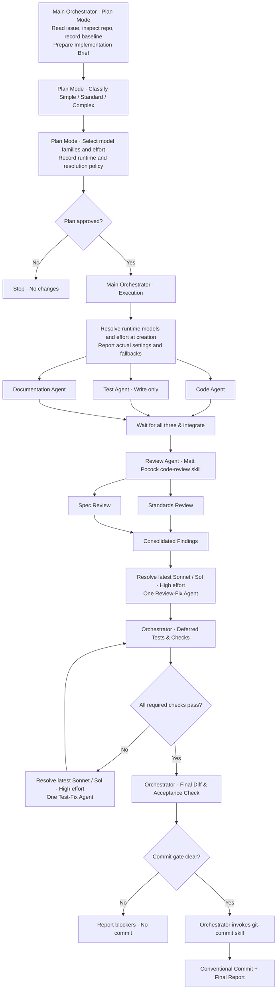

# GitHub Issue Workflow

A reusable agent skill to implement **any GitHub issue** with strict parallel implementation, independent standards/spec review, high-effort remediation, deferred validation, and a final Conventional Commit.

## How it works

The **main session starts in Plan Mode**. It reads the issue, maps requirements to the repository, identifies a fixed Git baseline, notes any unrelated working-tree edits, and presents a plan. **No edits or tests happen in Plan Mode.** Once the plan is approved and execution begins, the orchestrator launches exactly **three parallel, clean-context agents**: one for production code, one for automated tests (written but not run), and one for documentation.

When all three finish, a review agent invokes **Matt Pocock's installed `code-review` skill**, reviewing the changes **since the baseline** on two axes: **Standards** (documented repository standards) and **Spec** (the originating issue). The review skill's own parallel subagents examine those axes and report them side by side. One high-effort agent addresses actionable findings.

**Only after review remediation** does the orchestrator run builds, checks, and tests in increasing scope. If something fails, a high-effort debugging agent fixes root causes and the orchestrator reruns checks. On success, the **orchestrator itself invokes the installed `git-commit` skill** to create a Conventional Commit. No separate commit agent; no automatic push or PR.

## Workflow diagram



> The implementation agents run concurrently; later phases are sequential. The Standards and Spec branches are launched by the **code-review skill itself**, not by extra implementation agents.

## Model selection and complexity

During Plan Mode, record complexity and rationale, the detected runtime, preferred model families and requested reasoning efforts for implementation and remediation, review delegation, and the dynamic resolution/fallback policy in the Implementation Brief. Resolve actual settings at agent creation; model configuration needs no separate approval gate.

### Model-family assignments

| Agent | Claude Code | Codex |
| --- | --- | --- |
| Code | Latest available Sonnet | Latest available Sol |
| Tests | Latest available Sonnet | Latest available Sol |
| Documentation | Latest available Haiku | Latest available Luna |
| Code Review | Managed by code-review skill | Managed by code-review skill |
| Review Remediation | Latest available Sonnet | Latest available Sol |
| Test Remediation | Latest available Sonnet | Latest available Sol |

These are logical preferences, not model identifiers. The skill pins no model versions. Matt Pocock's `code-review` skill controls its internal selection; the review wrapper uses runtime defaults.

### Complexity and effort

- **Simple:** Localized modifications, straightforward logic, minimal dependencies.
- **Standard:** Multiple related changes, moderate complexity, or meaningful regression risk.
- **Complex:** Architectural changes, concurrency, advanced DSP, numerical algorithms, realtime processing, or significant cross-module interactions.

Default to **Standard** when uncertain. Complexity affects model configuration and effort only: every issue still uses exactly three parallel implementation agents.

| Complexity | Code | Tests | Documentation |
| --- | --- | --- | --- |
| Simple | Medium | Medium | Low |
| Standard | High | Medium | Low |
| Complex | High | High | Medium |

Both remediation roles always request **High effort**. Correctness, acceptance criteria, and required coverage remain mandatory for every profile.

### Dynamic resolution and fallbacks

At every implementation or remediation agent creation, detect Claude Code or Codex and inspect its supported model configuration, catalog, and effort controls. Prefer native version-independent aliases only when the runtime documents that they select the newest compatible member of the preferred family. Otherwise, select the newest compatible catalog entry using available release/version evidence. Never assume an unversioned alias means latest, invent identifiers or parameters, or add lookup scripts, dependencies, or configuration files. Runtime information takes priority over unnecessary web searches.

If the preferred family is unavailable, use a suitable supported fallback and report the actual model and reason. If latest status cannot be verified, disclose that uncertainty. Apply effort only where supported; prefer a supported level at least as high as requested when available, otherwise use the supported default. If explicit model/effort configuration is unsupported, proceed with runtime defaults and report the limitation. Mark actual settings unknown when the runtime does not expose them. Never silently substitute or claim unsupported settings were applied.

Record requested and actual settings, resolution evidence, and limitations in launch summaries and the final report. Explicit user configuration takes precedence. New agents retain fresh isolated contexts using supported runtime controls; reusing a debugging agent retains its existing configuration. Detailed operational instructions live in [agent-contracts.md](references/agent-contracts.md).

## Install

Copy the complete folder (including `references/`) into one of these project-level skill locations:

- **Claude Code:** `.claude/skills/github-issue-workflow/`
- **Codex:** `.agents/skills/github-issue-workflow/`

The skill has a `SKILL.md` frontmatter with name, description and an argument hint. Host-specific invocation and Plan Mode mechanisms may differ. Start the host in **Plan Mode** before invoking.

## Use

For Claude Code, when slash-command skill invocation is supported:

```text
/github-issue-workflow https://github.com/OWNER/REPO/issues/123
```

For Codex, when skill invocation is supported:

```text
$github-issue-workflow https://github.com/OWNER/REPO/issues/123
```

Alternatively, select the skill in the host UI and pass a GitHub issue URL. It is **not tied to a specific repository or issue**.

## Required dependencies

- A GitHub issue-reading mechanism (for example a connected GitHub tool or authenticated `gh`).
- A subagent runtime supporting three concurrent implementation agents and clean contexts.
- **Matt Pocock's `code-review` skill** installed and invocable; must support Standards and Spec parallel reviews.
- A **`git-commit` skill** installed and invocable by the orchestrator for Conventional Commits.
- Runtime model/effort controls where available. Preferences are latest available Sonnet/Sol at High effort for remediation; supported fallbacks or defaults are disclosed when explicit selection is unavailable.

The installed review and commit skills remain required. Model fallbacks are permitted under the documented resolution policy and are always disclosed.

## Token-efficiency design

- The orchestrator keeps a short Implementation Brief and reuses verified planning findings to avoid repeated broad exploration.
- Agent context is specific to each role; agents inspect other files only when necessary.
- Agent handoffs are concise (typically 200–400 words), with file paths and decisions rather than pasted diffs.
- Reviews target the baseline changes and inspect nearby dependencies only as needed.
- Tests are staged **after** review fixes: fast checks, focused tests, broader suites.
- Verbose test logs are stored in temporary files instead of repeatedly pasted into conversations.
- Related debugging cycles can reuse the existing fix agent.
- Documentation uses the lighter preferred family; implementation effort follows complexity while remediation always requests High.
- Avoid redundant agents, reviews, and test executions; rerun when changes or failures justify it.
- Commit runs in the orchestrator, removing the overhead of another subagent.

Token efficiency must never replace required review, correctness, acceptance criteria, or validation.

## Safety and limitations

- **Existing edits:** the orchestrator records pre-existing Git changes and avoids staging or overwriting unrelated user work.
- **No premature checks:** production builds, test suites, lint and static analysis are deferred until after code review and review fixes.
- **No automatic commit on failure:** failed required checks, unaddressed blockers, or a missing `git-commit` skill leave the working tree uncommitted.
- **No push/PR:** the skill creates only a local commit, unless a separate user request explicitly asks for more.
- **Host capabilities vary:** Plan Mode approval, model selection, clean-context spawning, and nested review agents depend on the execution environment.

## Files

```text
github-issue-workflow/
├── SKILL.md
├── README.md
└── references/
    ├── agent-contracts.md
    └── validation.md
```

The root skill is deliberately concise. Supporting instructions are split into reference files to avoid loading every detail at every phase.
